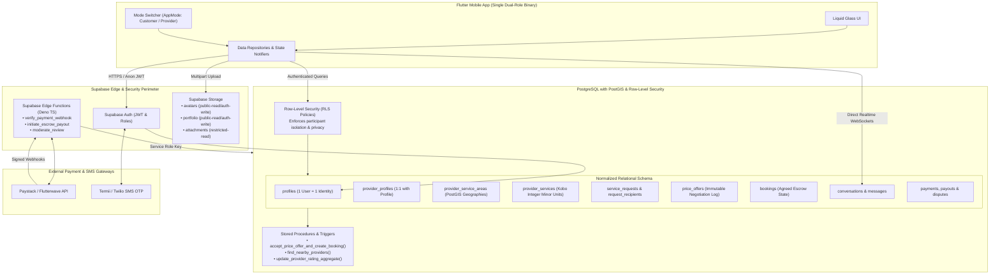
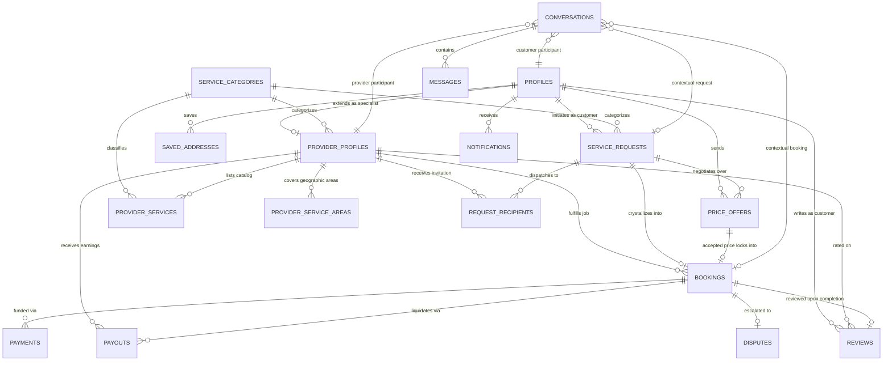

# Soama Marketplace: Production Backend Architecture & Database Design

## 1. Executive Summary & Architecture Overview

The **Soama Services Marketplace** targets homeowners and commercial property managers in Warri, Effurun, and the greater Delta State metropolis, connecting them with verified artisans and technical service professionals.

This document specifies the production backend architecture, database schema, security rules, and state machine transitions.

### 1.1 Target Technology Stack

| Layer | Technology | Rationale & Responsibility |
| :--- | :--- | :--- |
| **Mobile Client** | Flutter (Dart 3.5+) | Dual-role customer & provider mobile application featuring the Liquid Glass UI. |
| **Authentication** | Supabase Auth (GoTrue) | Real identity management, secure JWT token issuance, OTP verification. |
| **Database** | PostgreSQL 15+ with PostGIS | ACID relational integrity, spatial geography calculations, JSONB attributes. |
| **Spatial Engine** | PostGIS (`geography` type) | Radius searching, geodesic polygon matching, distance sorting without floating-point drift. |
| **Storage** | Supabase Storage (S3-compatible) | Portfolio media, avatar assets, and customer dispute attachments with strict RLS buckets. |
| **Realtime** | Supabase Realtime (WebSockets) | Instant negotiation updates, direct messaging threads, and booking status sync. |
| **Edge Compute** | Supabase Edge Functions (Deno / TypeScript) | Escrow payment webhooks (Paystack / Flutterwave), atomic booking locking, automated payouts. |
| **Secrets Engine** | Supabase Vault / Edge Environment | Stores payment gateway secrets, service role keys, and SMS gateway credentials. |

---

## 2. Architecture Diagram



---

## 3. Entity Relationship Diagram (ERD)



---

## 4. Dual-Role Identity & Permission Model

### 4.1 Single Identity Invariant
In accordance with production marketplace standards, **a single user must never have multiple accounts** to operate as both a customer and a service provider.

1. **`auth.users` (Supabase)**: Holds unique email, hashed password, phone number, and verified credentials.
2. **`public.profiles`**: Holds personal identity (`full_name`, `email`, `phone_number`, `avatar_url`), notification preferences, and customer capability flags (`has_customer_capability = TRUE`).
3. **`public.provider_profiles`**: Has a primary key `id` that directly references `public.profiles(id)` (`1:1` relationship).
   - If a record exists in `provider_profiles`, the user possesses provider capabilities.
   - If no record exists, the user is exclusively a customer.
4. **App Mode Preference (`selected_app_mode`)**:
   - The user's active client mode (`'customer'` or `'provider'`) is stored in `profiles.selected_app_mode`.
   - **Crucial Security Rule**: The client mode is treated strictly as an **interface layout preference**, NEVER as an authorization bypass. Server-side RLS and database triggers check `EXISTS (SELECT 1 FROM provider_profiles WHERE id = auth.uid() AND verification_status = 'approved')` before permitting any provider-specific mutations.

### 4.2 Verification Lifecycle
Artisans and technicians in Delta State handle physical home repairs and machinery. Therefore, providers are **never verified by default**:

```
[incomplete] ──(complete onboarding)──> [pending_verification]
                                              │
                      ┌───────────────────────┴───────────────────────┐
                      ▼                                               ▼
                  [approved]                                      [rejected]
                      │                                               │
               (misconduct)                                    (re-submit docs)
                      │                                               │
                      ▼                                               ▼
                 [suspended]                                    [pending_verification]
```

- **`incomplete`**: Provider has initiated onboarding but has not provided requisite catalog or coverage information.
- **`pending_verification`**: Provider profile is complete. Awaiting administrator / artisans board credential confirmation. Can browse incoming demo requests but cannot receive live escrow payouts.
- **`approved`**: Verified artisan. Displayed in public nearby search and eligible to accept confirmed jobs.
- **`suspended`**: Temporarily or permanently disabled due to customer dispute, safety violation, or fraud review.

---

## 5. Monetary Calculation & Precision Invariants

To eliminate floating-point representation errors:
1. **Integer Minor Units (Kobo)**:
   All monetary columns (`price_minor_units`, `agreed_price_minor_units`, `amount_minor_units`, `fee_minor_units`) are stored as `BIGINT`.
   - Example: ₦8,500.00 is represented as `850000`.
   - Example: ₦120,000.00 is represented as `12000000`.
2. **Explicit Currency Code**:
   Every monetary table enforces an ISO-4217 currency column (`currency TEXT NOT NULL DEFAULT 'NGN'`).
3. **No Floating-Point Arithmetic**:
   Database functions, calculations, and escrow splits utilize integer arithmetic (`ROUND((amount * fee_basis_points) / 10000)`).

---

## 6. Location Security & PostGIS Geospatial Queries

### 6.1 Privacy Protection Rules
1. **Customer Location Obfuscation**:
   - When a customer submits a service request, only the broad `location_area` ('Effurun Roundabout' or 'GRA Phase 2, Warri') and approximate coordinates (snapped to a ~1.5km grid) are visible to unconfirmed providers.
   - Exact street address (`address_line`) and high-precision coordinates are strictly revealed **only after** an offer is accepted and a confirmed booking record is created in `bookings`.
2. **Provider Coverage Matching**:
   - Provider service areas are stored as PostGIS `geography(Point, 4326)` with a radial boundary in meters (`radius_meters`), and optional `geography(Polygon, 4326)`.
   - The query checks whether the customer's approximate point falls within the provider's active coverage:
     ```sql
     ST_DWithin(provider_service_areas.center_point, customer_point, provider_service_areas.radius_meters)
     ```

---

## 7. Atomic Negotiation & Booking State Machine

To prevent race conditions where two providers accept the same customer request or a customer accepts two conflicting offers:

1. **Offer Submission**:
   - Offers are appended as immutable records in `price_offers`.
   - Submitting a new offer automatically marks prior pending offers from the same sender as `superseded`.
2. **Atomic Acceptance Procedure (`accept_price_offer_and_create_booking`)**:
   - Executed via a PostgreSQL `SECURITY DEFINER` stored function with `SERIALIZABLE` or `ROW LEVEL LOCKING` (`SELECT FOR UPDATE`).
   - Validates that:
     a) The caller is the authentic recipient of the offer.
     b) The offer is in status `'pending'`.
     c) The associated `service_request` is not already booked or cancelled.
   - In a single atomic transaction:
     a) Updates the accepted offer to `'accepted'`.
     b) Marks all other pending offers on the request as `'superseded'`.
     c) Creates the confirmed `bookings` record locking the `agreed_price_minor_units`.
     d) Updates `service_requests.status` to `'scheduled'`.
     e) Emits automated notifications to both parties.
